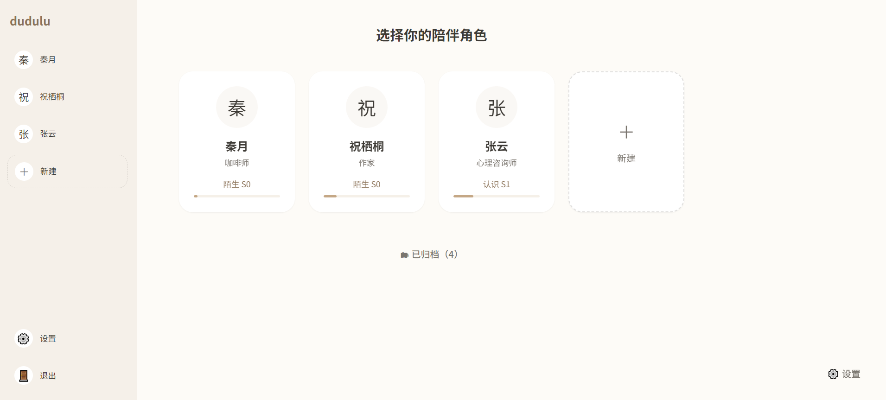
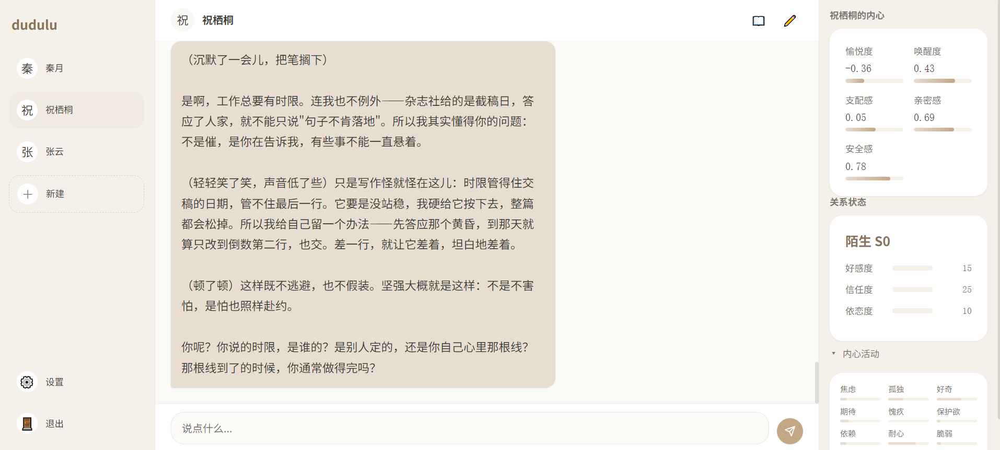
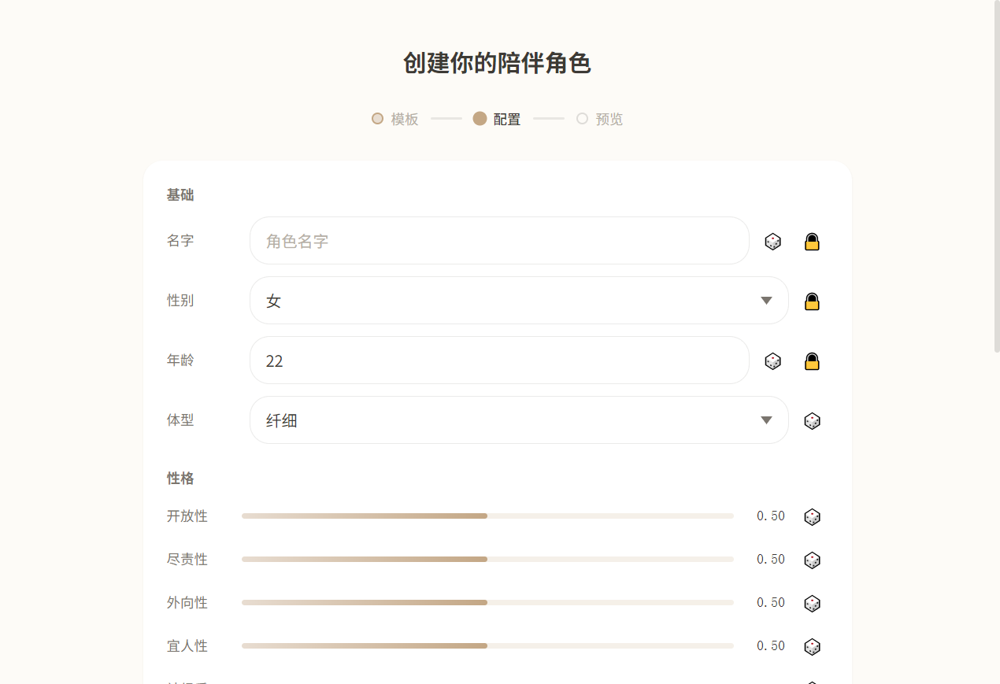
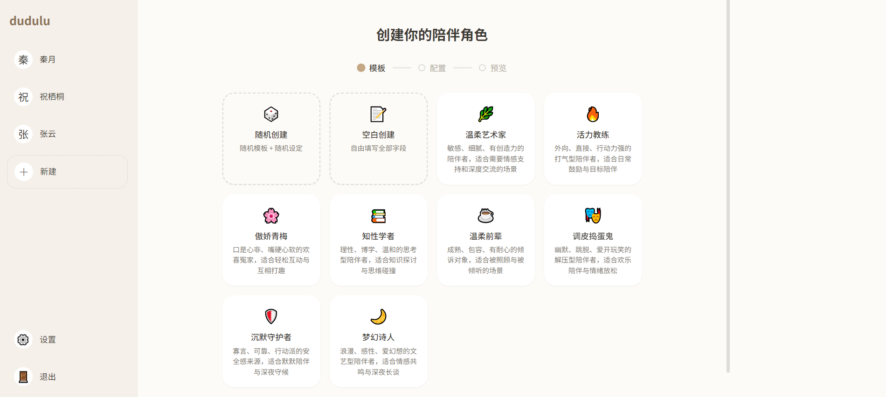

# dudulu · 嘟嘟噜

一个**有情绪、会主动找你**的 AI 陪伴角色后端 + 前端。

与普通聊天机器人的根本区别：每个角色由**确定性情感引擎**驱动（表达层 /
内部层 / 情感层三层状态、衰减、事件冲击、关系阶段），主动行为由引擎
决定"是否"和"何时"、LLM 只决定"说什么"。

- 技术栈：FastAPI + SQLAlchemy/SQLite + YantrikDB（嵌入式记忆库）+
  Alpine.js（零构建前端）
- 文档：`00-项目总览.md`（导航）、`01-产品与数值设计.md`（产品与数值）、
  `02-后端架构.md`（API 与模块）、`03-前端设计.md`（界面规范）
- 变更记录：`CHANGELOG.md`　许可：`LICENSE`（MIT）

> **⚠️ 项目性质说明**：这是一个**玩具级别的个人项目**——主要代码由 AI
> 完成，**没有经过大量人工测试**，数值参数多为经验值，仅适合玩一玩。

## 截图

| 角色选择 | 对话 |
| :--- | :--- |
|  |  |

| 创建角色 | 创建面板 |
| :--- | :--- |
|  |  |

右侧状态面板实时显示角色的三层数值（愉悦度 / 支配感 / 安全感 / 关系
阶段），每轮对话后由 WebSocket 推送更新。

---

## 目录结构

```
dudulu/
├── backend/                    # 后端（FastAPI）
│   ├── main.py                 # 入口：API 路由 + WS + 前端静态托管 + 调度器
│   ├── run.py                  # 开发启动入口（Windows 友好的单进程）
│   ├── requirements.txt
│   ├── pytest.ini / alembic.ini
│   ├── .env                    # 本地联调配置（不入库，见下文）
│   ├── api/                    # 路由：auth/session/message/state/memory/
│   │                           #   character/template/config/chat/ws
│   ├── core/                   # 情感引擎 + 角色层（模板/随机/校验/主题）
│   ├── orchestrator/           # 对话管道（12 步）+ 分类器/装配/后处理
│   ├── memory/                 # MemoryManager + 沉淀调度器
│   ├── scheduler/              # APScheduler 任务 + 独立调度进程入口
│   ├── db/                     # 模型/连接/迁移（Alembic）
│   ├── llm/                    # LLM 客户端（API/Local 两种模式）
│   ├── config/                 # 数值配置 + 提示词模板
│   ├── scripts/e2e_smoke.py    # 全链路 E2E 冒烟脚本
│   └── tests/                  # 700 个用例
├── frontend/                   # 前端（零构建，Alpine.js）
│   ├── index.html              # 唯一 HTML 入口（hash 路由）
│   ├── css/                    # tokens/base/layout + 组件 + 页面
│   ├── js/                     # api/ws/sse/store/router + 9 个页面组件
│   ├── check-modules.mjs       # Node 冒烟：模块图 + 时序契约
│   ├── check-components.mjs    # Node 冒烟：组件行为（7 组用例）
│   ├── check-render.mjs        # 可选：jsdom + Alpine 真实渲染验证
│   └── assets/vendor/          # Alpine.js 本地副本（无 CDN 依赖）
├── docs/screenshots/           # README 截图
├── 00~03 设计文档（4 份）       # 产品/数值/后端/前端的完整设计
├── CHANGELOG.md                # 变更记录（按 Phase）
├── LICENSE                     # MIT
└── data/                       # 运行时生成：SQLite + YantrikDB（在 backend/data/，已忽略）
```

---

## 一、环境要求

| 项 | 要求 | 说明 |
| :--- | :--- | :--- |
| Python | **3.12**（conda 环境） | 开发与测试均在 3.12.8 验证 |
| 依赖 | `backend/requirements.txt` | `pip install -r requirements.txt` |
| Node | 可选（≥18） | 仅用于 `node --check` 校验前端 JS 语法，运行不需要 |
| 网络 | 首次启动需联网一次 | YantrikDB 默认嵌入器首次运行下载 ~28MB 模型 |
| LLM | 一个 OpenAI 兼容端点 + Key | 默认指向 ant-ling（见 `.env`） |

---

## 二、快速开始（5 分钟跑起来）

### 1. 创建 conda 环境并安装依赖

```bash
# 创建 + 激活 conda 环境（Python 3.12）
conda create -n dudulu python=3.12 -y
conda activate dudulu

# 安装依赖
cd backend
pip install -r requirements.txt
```

> 环境名 `dudulu` 可自取；退出环境用 `conda deactivate`，
> 删除环境用 `conda remove -n dudulu --all`。

### 2. 配置 `.env`

在 **仓库根目录**（`dudulu/.env`，与 `backend/` 同级）创建。后端启动时
自动读取，所有键带 `DUDULU_` 前缀：

```bash
# ── 必填：LLM（OpenAI 兼容端点）──
DUDULU_LLM_API_PROVIDER=openai
DUDULU_LLM_API_KEY=sk-你的key
DUDULU_LLM_API_MODEL=Ling-3.1-flash
DUDULU_LLM_API_BASE_URL=https://api.ant-ling.com/v1/

# ── 可选：其余全部有默认值，见下方配置表 ──
```

> `.env` 已在 `.gitignore` 管理外（本地文件，不要提交）。

### 3. 启动（一条命令，前后端一起起）

```bash
cd backend
python run.py                 # 推荐：单进程，Ctrl+C 干净退出
# 或直接：
uvicorn main:app --port 8000
```

- 前端：**http://localhost:8000/** （静态托管，hash 路由）
- API 文档：**http://localhost:8000/docs** （Swagger UI）
- WebSocket：`ws://localhost:8000/ws/events`

首次启动会自动：建表（幂等）→ 下载嵌入模型（约 28MB，之后离线可用）→
启动调度器（沉淀任务 + 主动行为心跳）。

**关于 `--reload`（Windows 用户必读）**：`uvicorn main:app --reload` 的
热重载父进程在 Windows 上 Ctrl+C 后可能卡住——日志停在
`Finished server process [pid]`、cmd 不返回。原因是父进程的主循环阻塞在
watchfiles 的 Rust watcher 里，等不到第二次信号，而 `basereload.shutdown()`
对子进程 `join()` 没有超时（uvicorn 上游问题，非本项目代码）。
**日常开发用 `python run.py`（单进程，Ctrl+C 立即退出，已实测 3.4s 干净收尾）；
确需热重载时用 `python run.py --reload`，卡住就再按一次 Ctrl+C。**

### 4. 使用前端

浏览器打开 http://localhost:8000/ ，按页面走一遍：

| 页面 | 路由 | 做什么 |
| :--- | :--- | :--- |
| 登录/注册 | `#/login` | 注册即登录（自动签发 token） |
| 角色选择 | `#/characters` | 卡片网格；点卡片进入聊天 |
| 创建向导 | `#/character/create` | 三步：选模板 → 配置（可锁定字段/随机）→ 预览创建 |
| 聊天 | `#/chat/{id}` | 对话、SSE 流式输出、右侧状态面板实时更新 |
| 记忆浏览器 | `#/memory` | 搜索 + 情感标签/时间筛选 |
| 角色编辑 | `#/character/{id}/edit` | 基础信息/主题色/高级设置/版本历史回滚/导出归档 |
| 设置 | `#/settings` | 账号、LLM 配置（**用户级覆盖**）、主动行为、导入导出 |

> token 存 `localStorage`；API 401 会自动跳登录页。

---

## 三、配置项（环境变量，全部可选）

在 `.env` 里覆盖（前缀 `DUDULU_`）：

| 键 | 默认 | 说明 |
| :--- | :--- | :--- |
| `LLM_API_PROVIDER` | `openai` | 提供方名（仅记录用） |
| `LLM_API_KEY` | 空 | API Key；**空时客户端用 `EMPTY` 占位**，调用时才报认证错 |
| `LLM_API_MODEL` | `gpt-4o` | 模型名 |
| `LLM_API_BASE_URL` | `https://api.ant-ling.com/v1/` | OpenAI 兼容端点 |
| `LLM_MODE` | `api` | `api`（远程）/ `local`（本地部署，协议相同） |
| `LLM_LOCAL_BASE_URL` | `http://localhost:8000/v1` | local 模式地址 |
| `LLM_LOCAL_MODEL` | `qwen3.6-35b-a3b` | local 模式模型 |
| `SQLITE_PATH` | `data/dudulu.db` | SQLite 路径（相对 backend/ 运行目录） |
| `YANTRIK_PATH` | `data/yantrik/dudulu_memory.db` | 记忆库路径 |
| `YANTRIK_EMBEDDER` | `default` | `default`=捆绑模型（首次联网下载）；`fake`=假嵌入器（**仅测试/调试**） |
| `SECRET_KEY` | `change-me-in-production` | JWT 密钥，**生产必须改** |
| `TOKEN_EXPIRE_DAYS` | `30` | token 有效期 |
| `SCHEDULER_ENABLED` | `true` | 本进程内跑调度器（见"两种部署形态"） |
| `PROACTIVE_TICK_MINUTES` | `15` | 主动行为心跳间隔（E2E/调试可设 0.05） |
| `PROACTIVE_INTERVAL_HOURS` | `4.5` | 全局审视间隔默认值 |
| `PROACTIVE_SILENCE_THRESHOLD` | `3` | 连续无回复阈值 |
| `PROACTIVE_MAX_DAILY` | `3` | 每日主动消息上限 |
| `PROACTIVE_QUIET_HOURS` | `(23, 8)` | 静默时段（用户本地时间） |
| `EMOTION_CONFIG_PATH` | `config/dudulu_config.yaml` | 数值配置 |

运行时改配置不重启：**设置页**（`#/settings`）写用户级覆盖，即时生效。

---

## 四、API 使用方式

统一约定：除认证外所有端点带 `Authorization: Bearer <token>`；
请求带 `X-Timezone: <IANA 时区名>`（后端据此判静默时段，缺省 Asia/Shanghai）。

### 最小对话流程（curl）

```bash
# 1. 注册（直接返回 token）
TOKEN=$(curl -s -X POST localhost:8000/api/auth/register \
  -H 'Content-Type: application/json' \
  -d '{"username":"me","password":"secret123"}' | python -c "import sys,json;print(json.load(sys.stdin)['token'])")

# 2. 从模板建角色
curl -s -X POST localhost:8000/api/character/create/template \
  -H "Authorization: Bearer $TOKEN" -H 'Content-Type: application/json' \
  -d '{"template_id":"gentle_artist","name":"知夏"}'

# 3. 非流式对话
curl -s -X POST localhost:8000/api/chat \
  -H "Authorization: Bearer $TOKEN" -H 'Content-Type: application/json' \
  -d '{"character_id":"<上一步的id>","session_id":"s1","message":"你好"}'

# 4. 流式对话（SSE，事件按 \n\n 分隔：token* → done）
curl -N -X POST localhost:8000/api/chat/stream \
  -H "Authorization: Bearer $TOKEN" -H 'Content-Type: application/json' \
  -d '{"character_id":"<id>","session_id":"s1","message":"今天累了"}'
```

### WebSocket（实时推送）

连 `ws://localhost:8000/ws/events`，**首条消息必须认证**：

```json
→ {"type": "auth", "token": "<JWT>"}
← {"type": "auth_ok"}
```

之后服务端推送两类消息：

- `state_update`：每轮对话后推送完整三层状态 + `delta`
  （`{type, character_id, expression, internal, affective, delta}`）
- `proactive_message`：角色主动找你
  （`{type, character_id, message, reason, priority, timestamp}`）

一个用户可开多个连接；多角色页面按 `character_id` 过滤。

### 端点全景（33 个）

| 分组 | 端点 |
| :--- | :--- |
| 认证 | `POST /api/auth/register` · `POST /api/auth/login` · `PUT /api/auth/password` |
| 会话 | `POST /api/session/create` · `POST /api/session/{id}/end` · `GET /api/session/active` |
| 消息 | `GET /api/messages/recent?character_id=&limit=` |
| 对话 | `POST /api/chat` · `POST /api/chat/stream` |
| 状态 | `GET /api/state?character_id=` |
| 记忆 | `GET /api/memory/search?character_id=&q=&emotion_tag=&time_range=&limit=` |
| 角色 | 列表/详情/创建×3/更新/归档/恢复/切换/导出/导入/版本/回滚（见 `/docs`） |
| 模板 | `GET /api/template/list` 等 5 个 |
| 配置 | `GET/PUT /api/config/llm` · `GET/PUT /api/config/proactive` |

完整schema以 `http://localhost:8000/docs` 为准。

---

## 五、两种部署形态

调度器（沉淀 + 主动心跳）在一个进程里跑就够，多进程跑会重复：

**开发 / 单进程（默认）**——Web 进程自带调度器，主动消息可实时推送：

```bash
uvicorn main:app --host 0.0.0.0 --port 8000
```

**生产 / 多 worker**——Web 进程关调度，独立进程跑全局一份：

```bash
# Web 进程（可多 worker 横向扩展）
DUDULU_SCHEDULER_ENABLED=false uvicorn main:app --workers 4 --port 8000

# 独立调度进程（全局一份）
DUDULU_SCHEDULER_ENABLED=true python -m scheduler.run
```

> 已知限制：独立调度进程没有 WS 连接，主动消息照常落库，
> 前端下次进入聊天页拉 `/api/messages/recent` 时看到（有意的降级）。

---

## 六、测试

```bash
cd backend

# 全量测试（700 个用例）
# 依赖 pytest（未列入 requirements.txt，先 pip install pytest pytest-cov）
python -m pytest

# 带覆盖率（要求：每个模块 ≥ 80%，当前总覆盖 97%）
python -m pytest --cov=core --cov=llm --cov=api --cov=config \
  --cov=orchestrator --cov=memory --cov=db --cov=auth --cov=scheduler \
  --cov-report=term-missing

# 只跑某一组
python -m pytest tests/test_proactive_engine.py -q
```

标记说明：`@pytest.mark.integration` 的用例（真实 LLM 调用）默认
`deselect`，需要时加 `-m integration`（会消耗真实 API 配额）。

### 全链路 E2E 冒烟（真实后端 + 真实 LLM）

```bash
cd backend
python scripts/e2e_smoke.py
```

脚本会：起临时 uvicorn（临时库，不碰 `data/`）→ 注册 → WS 认证 → 建角色
→ 非流式/流式对话 → 校验 WS 推送 → 改 LLM 配置 → 缩短心跳触发**真实
主动消息** → 全部通过退出码 0。共 15 项检查。

### 前端 JS 检查（可选，需要 Node）

```bash
cd frontend

# 1. 语法检查（对 js/ 下所有文件）
Get-ChildItem -Recurse js -Filter *.js | ForEach-Object { node --check $_.FullName }

# 2. 模块图冒烟（更深一层：Node + DOM 桩真实 import app.js，
#    验证整条 import 链可解析、顶层求值无错误）
node check-modules.mjs

# 3. 真实渲染验证（可选）：jsdom + vendor Alpine 实际渲染「性格」区块，
#    验证 Alpine 绑定语义（x-for 对象遍历的解构顺序等）。
#    需先装 jsdom：npm install jsdom
node check-render.mjs
```

> `check-modules.mjs` 曾在开发期抓到真实事故：`import Alpine from
> 'alpinejs'` 是裸模块名，浏览器没有 import map 解析不了，导致整条
> 模块图加载失败、**页面全白**。现在 Alpine 一律从 `window.Alpine`
> 取（vendor IIFE 暴露的全局），并有测试锁死这条禁令。

---

## 七、数据库

- 开发/测试：启动时 `create_all` 自动建表（幂等）。
- 生产 schema 变更：**Alembic**（`backend/db/migrations/`）。

```bash
cd backend
python -m alembic current          # 查看版本
python -m alembic upgrade head     # 升级
python -m alembic downgrade -1     # 回退一步
```

已应用迁移示例（Phase 10）：`config` 表按 user 分区
（`8d0463ebacee` 初始 → `b2f1c4d7a906` user 分区）。

---

## 八、常见问题

**Q：首次启动很慢 / 卡在下载？**
首次运行 YantrikDB 默认嵌入器要下载 ~28MB 模型（之后离线可用）。
测试/调试想跳过：设 `DUDULU_YANTRIK_EMBEDDER=fake`（无语义能力）。

**Q：LLM 返回空？**
检查 `max_tokens`：推理型模型（如 Ling-3.1-flash）会用推理 token 吃光
额度，≤64 可能返回空。管道默认 1024，正常不受影响。

**Q：API 报 429？**
上游限流。等待重试；E2E 连续跑两次之间隔几分钟。

**Q：主动消息没来？**
五道硬性拦截：用户/角色开关、静默时段（按你的 `X-Timezone` 本地时间）、
退缩静默期、busy 期、频率门控（间隔/最小间隔/每日上限/对话中）。
设 `#/settings` 里主动行为开启 + 静默时段 `0 ~ 0` 再试。

**Q：前端页面一片空白？**
按概率排序：① **强制刷新**（Ctrl+F5）排除缓存；② 按 F12 看 Console
红色报错——最常见是模块加载失败（历史上出过 `import ... from
'alpinejs'` 裸模块名导致全白，已修并有防回归测试）；③ 确认
`frontend/assets/vendor/alpine.min.js` 存在（前端依赖加载失败时会
显示提示文案而不是空白）；④ 确认访问的是 `http://localhost:8000/`
且后端日志没有 404。都不灵就带 Console 截图报错内容。

**Q：改了设置没生效？**
设置页写的是**你的用户覆盖**（全局默认 + 你的覆盖合并视图），
不影响其他用户；LLM 配置改动对下一轮对话即时生效。

**Q：Windows 上时区相关出错？**
装 `tzdata`（requirements 已含）；`X-Timezone` 用 IANA 名
（`Intl.DateTimeFormat().resolvedOptions().timeZone`）。

---

## 九、已知限制（一期范围外）

1. 跨进程 WS 推送未实现（生产独立调度进程下降级为落库 + 拉取）；
2. 真正本地部署（ollama/vLLM）未实测（接口与 APIClient 同路径）；
3. 期待感检测用关键词（等分类器加 `anticipation_signal` 字段）；
4. 系统预置角色未种子化（新用户首进角色列表为空，用模板创建即可）；
5. LoRA 微调不在范围；
6. 左滑删除消息是**视图级**移除（后端暂无删除端点，刷新后恢复）。

**测试诚实说明**：700 个自动化用例覆盖后端全部模块（总覆盖率 97%），
但**人工 UI 测试很有限**——前端是逐轮修 bug 打磨出来的，边界情况
（极端网络、并发、异常输入）大概率还有没撞到的。欢迎提 issue。

详细设计与裁决记录见四份设计文档（`00-` ~ `03-`）。
